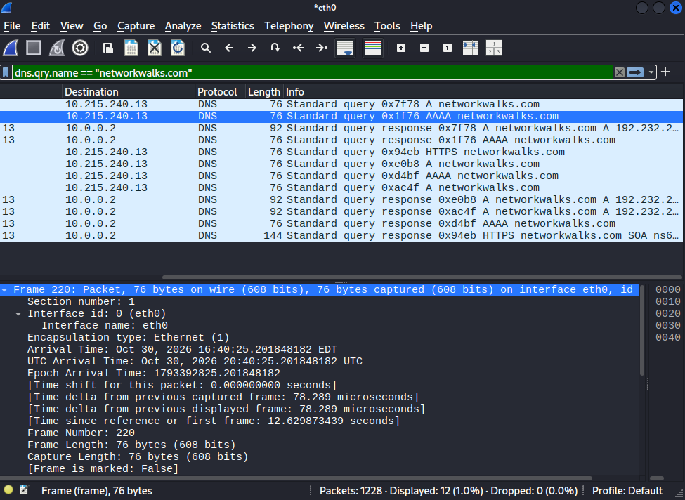
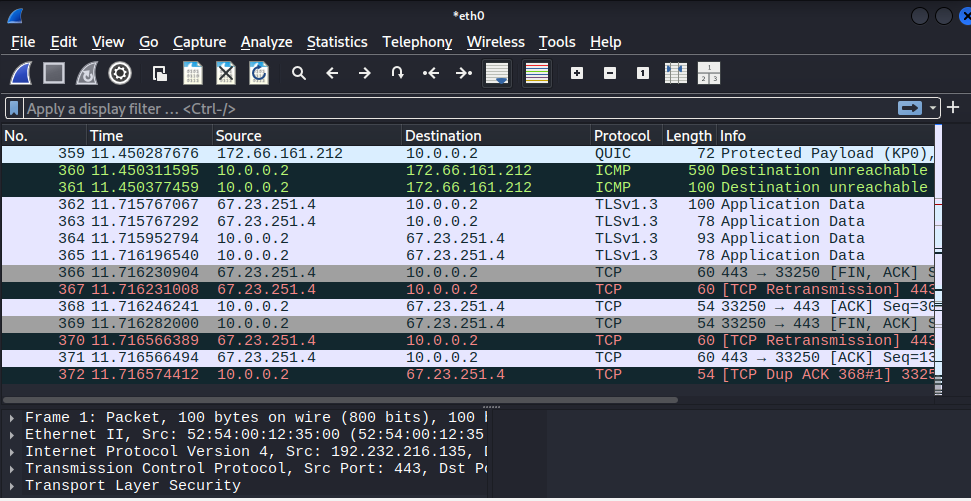
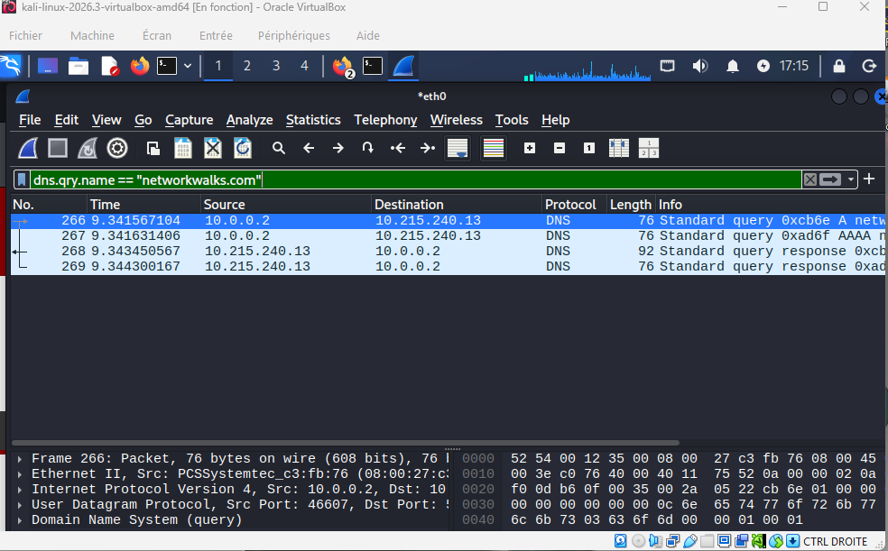
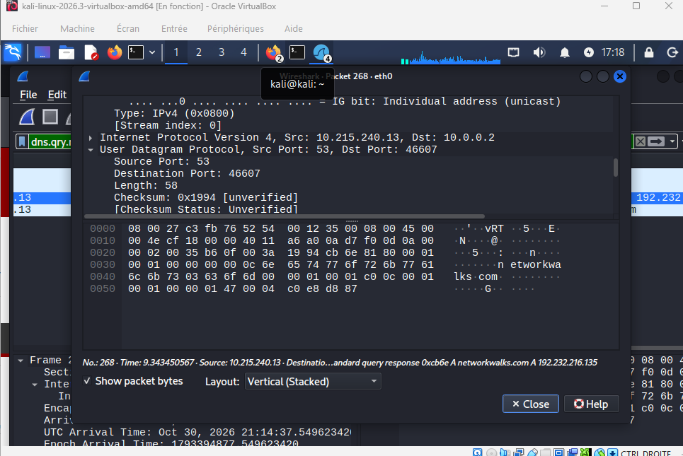
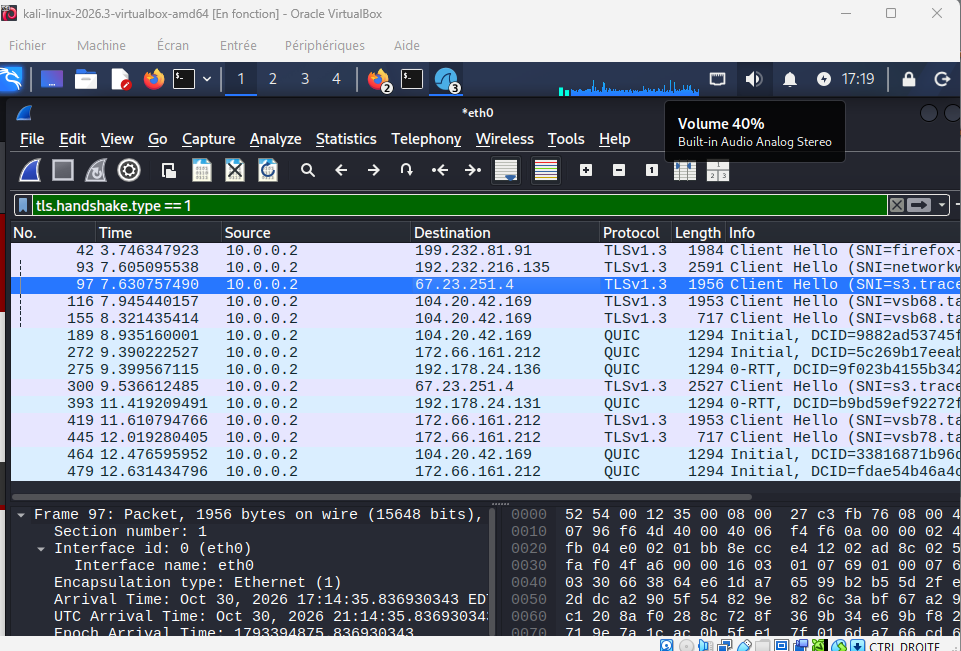
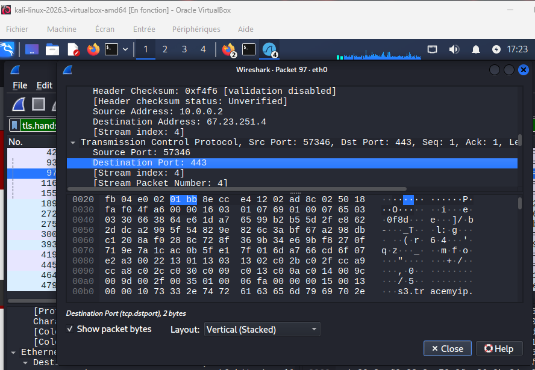
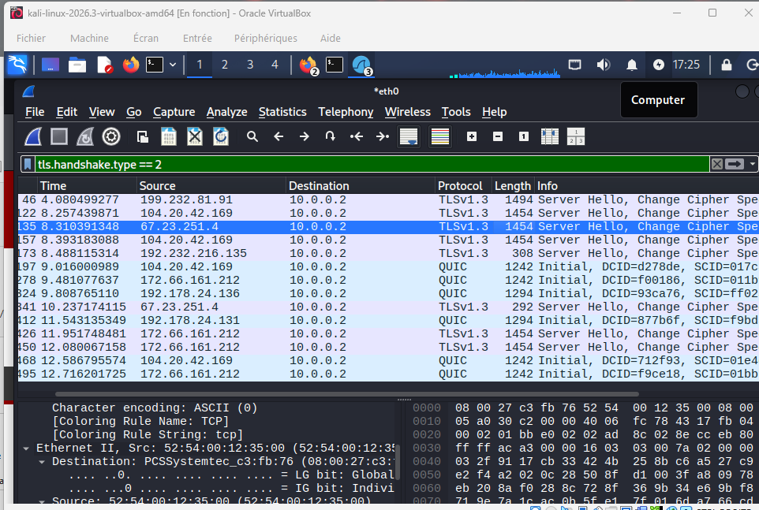

# 🔍 Lab 1: Introduction to Wireshark & Basic Packet Capture

**Capturing network traffic, inspecting protocol headers, and performing basic display filtering**

---

## 📌 Lab Overview

This lab focuses on capturing live network traffic using Wireshark within an isolated virtual environment (`Kali Linux` / VirtualBox). The objective is to understand packet structures across OSI layers, isolate specific protocol handshakes, and resolve query details like IP addresses, DNS responses, and TLS parameters.

---

## 🎯 Objectives & Questions Addressed

- Capture live traffic on interface `eth0` using Wireshark[cite: 11].
- Isolate DNS queries and responses using display filters (`dns.qry.name`)[cite: 11].
- Inspect TLS Client Hello and Server Hello packets to identify secure session details[cite: 15, 17].

### **Lab Questions & Answers:**
1. **What is the IP address of your own laptop?** $\rightarrow$ `10.0.0.2`[cite: 11]
2. **What is the IP address of your DNS server?** $\rightarrow$ `10.215.240.13`[cite: 11]
3. **What is the IP address of the website (`networkwalks.com` / target domain)?** $\rightarrow$ `192.232.216.135`[cite: 11]
4. **Which website name (Server Name) is sent in the TLS Client Hello?** $\rightarrow$ `s3.tracemyip.org` / target domain[cite: 15]
5. **Which server port is used for the secure connection?** $\rightarrow$ Port `443` (HTTPS)[cite: 16]
6. **Which TLS version does the website use?** $\rightarrow$ `TLSv1.3`[cite: 15]

---

## 🛠️ Key Wireshark Filters Used

- `dns.qry.name == "networkwalks.com"` — Isolates DNS queries and response traffic for the specified domain[cite: 11].
- `tls.handshake.type == 1` — Filters TLS Client Hello packets to inspect Server Name Indication (SNI)[cite: 15].
- `tls.handshake.type == 2` — Filters TLS Server Hello responses to verify negotiation parameters and protocol versions[cite: 17].

---

## 📊 Lab Verification Matrix

| Step / Test | Filter / Command | Expected Result | Status |
| :--- | :--- | :--- | :---: |
| **DNS Query Filter** | `dns.qry.name == ...` | Query and response packets visible | ✅ Pass[cite: 11] |
| **Laptop IP Identification** | Packet Details (`Src`) | Correct local interface IP (`10.0.0.2`) | ✅ Pass[cite: 11] |
| **TLS Handshake Inspection** | `tls.handshake.type == 1` | Client Hello SNI and port 443 identified | ✅ Pass[cite: 15, 16] |
| **TLS Version Verification** | `tls.handshake.type == 2` | Server Hello confirming `TLSv1.3` | ✅ Pass[cite: 17] |

---

## 📸 Proof of Execution & Visual Evidence

### 1. DNS Query Filter & Resolution (`w1.png`)

### 2. General Traffic & Connection States (`w2.png`)

### 3. DNS Standard Query Execution (`w3.png`)

### 4. Detailed Packet Byte Analysis (`w4.png`)

### 5. TLS Client Hello Filter & SNI (`w5.png`)

### 6. Transmission Control Protocol Port 443 Verification (`w6.png`)

### 7. TLS Server Hello & Version Confirmation (`w7.png`)

---

## 💡 What I Learned

1. **Traffic Isolation:** Using targeted display filters drastically reduces noise when analyzing captures.
2. **DNS Resolution Flow:** Tracking how a client requests an IP address from a local DNS server prior to establishing communication.
3. **Secure Handshakes:** Inspecting TLS Client/Server Hello extensions (such as SNI) to identify encrypted web application destinations.

---

## 👤 Author

**Malek Aroua**  
*Computer Networks Graduate | Cybersecurity Specialist*
