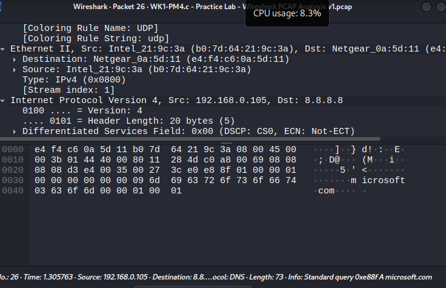
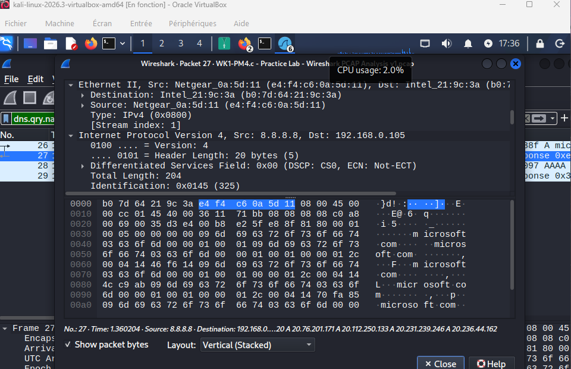
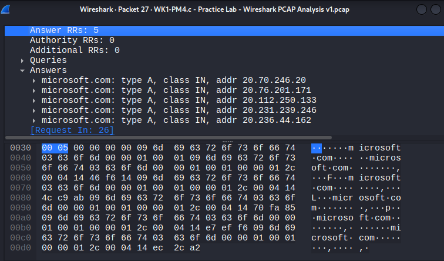
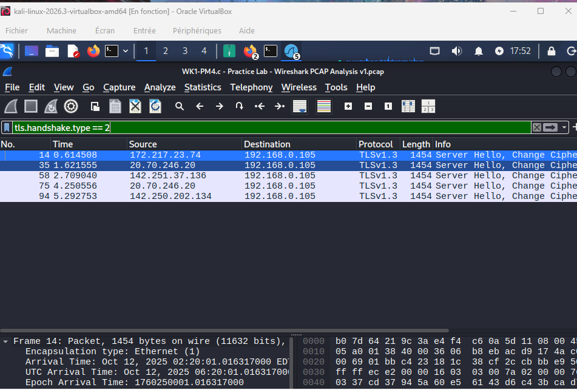
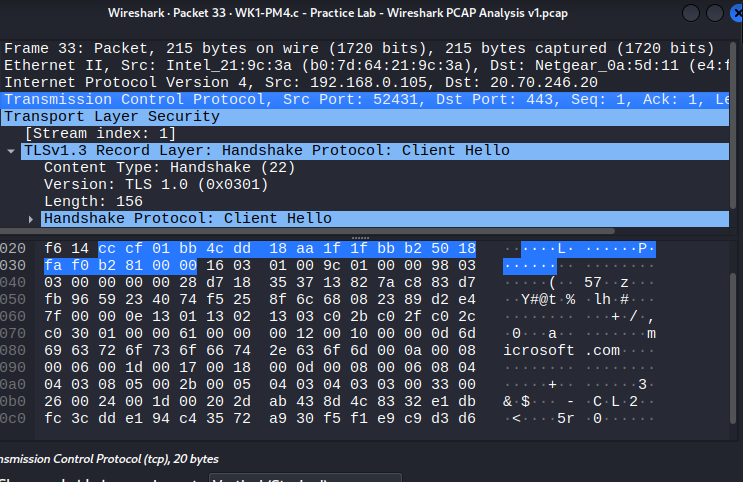
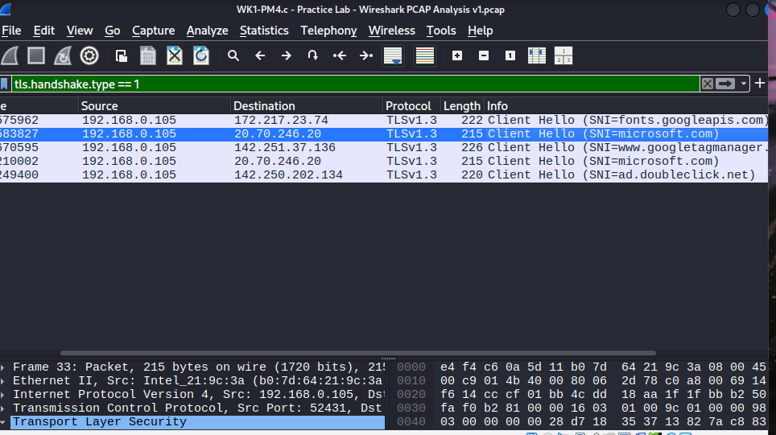

# 📊 Lab 2: Wireshark PCAP Traffic Analysis & Protocol Inspection

**Analyzing pre-captured trace files (`.pcap`), inspecting DNS resolution, and evaluating TLS secure handshakes**

---

## 📌 Lab Overview

This lab focuses on analyzing a pre-recorded network trace file (`.pcap`) using Wireshark. Instead of capturing live traffic, the objective is to open an existing packet capture session, filter specific protocols, analyze DNS query/response structures, and inspect encrypted web session handshakes (TLSv1.3).

---

## 🎯 Objectives & Questions Addressed

- Load and inspect saved trace files (`.pcap`) in Wireshark.
- Analyze DNS query packets and extract resolved IP address records (Type A).
- Use display filters to isolate TLS handshake types (`tls.handshake.type == 1` and `== 2`).
- Investigate Client Hello Server Name Indication (SNI) extensions for domain identification.

### **Lab Analysis & Findings:**
1. **Source IP of local host in PCAP:** $\rightarrow$ `192.168.0.105`[cite: 11]
2. **DNS Server IP:** $\rightarrow$ `8.8.8.8`[cite: 12]
3. **Target Domain Queried:** $\rightarrow$ `microsoft.com`[cite: 11]
4. **Resolved IP Addresses (Answer RRs):** Multiple IPv4 addresses including `20.70.246.20`, `20.76.201.171`, `20.112.250.133`[cite: 13]
5. **TLS Handshake Protocol Version:** $\rightarrow$ `TLSv1.3`[cite: 14, 15]
6. **Detected SNI Hostnames in Client Hello:** `fonts.googleapis.com`, `microsoft.com`, `www.googletagmanager.com`, `ad.doubleclick.net`[cite: 16]

---

## 🛠️ Key Wireshark Filters Used

- `dns.qry.name == "microsoft.com"` — Filters standard DNS queries and responses for Microsoft domains.
- `tls.handshake.type == 1` — Isolates TLS Client Hello packets to inspect SNI extensions.
- `tls.handshake.type == 2` — Filters TLS Server Hello responses to verify session cryptographic parameters[cite: 14].

---

## 📊 Lab Verification Matrix

| Analysis Step | Filter / View | Expected Result | Status |
| :--- | :--- | :--- | :---: |
| **PCAP File Loading** | `File > Open` | Trace file loaded successfully with packet list populated | ✅ Pass |
| **DNS Query Inspection** | Packet Details View | Client query for `microsoft.com` mapped to `8.8.8.8`[cite: 11, 12] | ✅ Pass |
| **DNS Answer Extraction** | Answer RRs Pane | Multiple Type A IP records resolved successfully[cite: 13] | ✅ Pass |
| **TLS Client Hello Filter** | `tls.handshake.type == 1` | Secure session initiation packets and SNI tags displayed | ✅ Pass |
| **TLS Server Hello Filter** | `tls.handshake.type == 2` | Server response confirming cryptographic parameters[cite: 14] | ✅ Pass |

---

## 📸 Proof of Execution & Visual Evidence

### 1. DNS Standard Query Packet & IPv4 Headers (`2w1.png`)

### 2. DNS Response Packet & Ethernet Layer Details (`2w2.png`)

### 3. DNS Answer Resource Records (Type A IPs) (`2w3.png`)

### 4. TLS Server Hello Filter (`2w4.png`)

### 5. TLS Client Hello Packet Inspection (`2w5.png`)

### 6. SNI Identification in Client Hello (`2w51.png`)

---

## 💡 What I Learned

1. **PCAP Analysis Workflow:** Opening and reviewing pre-captured network data files for offline security investigations.
2. **DNS Resolution Breakdown:** Examining packet bytes and packet details to verify how domain names map to multiple server IPs.
3. **Encrypted Traffic Inspection:** Using TLS handshake filters (`Client Hello` / `Server Hello`) to identify specific web destinations visited inside encrypted sessions.

---

## 👤 Author

**Malek Aroua**  
*Computer Networks Graduate | Cybersecurity Specialist*
